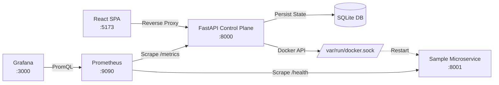
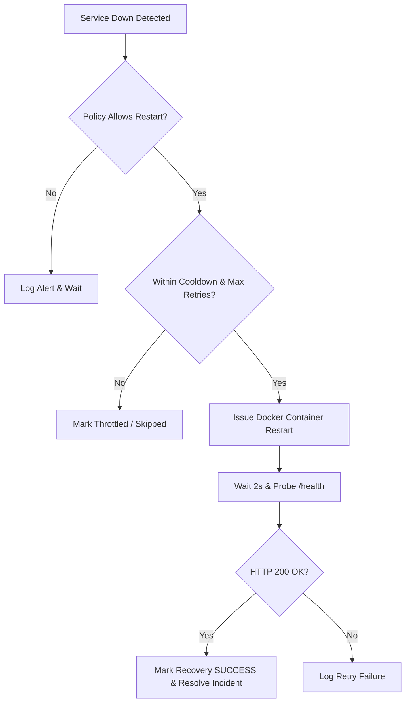

# ResiliOps
### Cloud-Native DevOps Automation and Self-Healing Platform

**College Internal Examination & Project Viva Voce**

- **Candidate Name:** [Student Name]
- **Enrollment / Roll No:** [Enrollment Number]
- **Department:** Computer Science & Engineering
- **Institution:** [College / University Name]
- **Project Supervisor:** [Faculty Guide Name]

---

## Slide 2: Project Introduction

- **What is ResiliOps?**
  - An autonomous, cloud-native DevOps automation and self-healing supervisory platform.
  - Bridges application performance monitoring, automated anomaly detection, and closed-loop infrastructure remediation.
- **Why is it needed?**
  - Modern microservices fail unexpectedly due to code bugs, memory leaks, and infrastructure glitches.
  - Manual remediation causes high Mean Time to Recovery (MTTR) and customer-facing downtime.
- **Core Philosophy:**
  - *"Detect anomalies instantly, recover microservices autonomously, and verify health before closing incidents."*

---

## Slide 3: Problem Statement

1. **Fragmented Monitoring:**
   - Development teams use disparate CLI tools, logs, and basic uptime checkers with no centralized view.
2. **Delayed Failure Detection:**
   - Transient errors and consecutive 5xx failures often go unnoticed until end-users complain.
3. **High Human Dependency:**
   - Operators must manually SSH into servers, find container IDs, and execute restart commands.
4. **Expensive Commercial Tools:**
   - Enterprise SRE suites (Datadog, Dynatrace, PagerDuty) require recurring, costly cloud subscriptions not suitable for academic study.

---

## Slide 4: Project Objectives

- **Continuous Health Probing:**
  - Automated asynchronous HTTP health checks and response time collection.
- **Intelligent Failure Detection:**
  - Rule-based detection (3 consecutive failures, CPU > 80%, RAM > 85%) with duplicate suppression.
- **Autonomous Self-Healing:**
  - Targeted Docker container restarts via daemon socket communication in under 3 seconds.
- **Operational Guardrails:**
  - Rollback to known-good deployment tags and horizontal autoscaling between boundary limits.
- **Zero-Cloud Architecture:**
  - 100% local operation using Docker Compose, Minikube, and local Terraform providers.

---

## Slide 5: Existing System vs. Proposed System

| Parameter | Traditional Manual Ops | ResiliOps Autonomous Platform |
|---|---|---|
| **Monitoring** | Manual log checks & reactive alerts | Continuous parallel async health checks |
| **Detection** | Human triage after customer reports | Rule-based engine with instant incident generation |
| **Remediation** | Manual SSH login & shell restart | Autonomous container restart & rollback (< 3s) |
| **Verification** | Assumed healthy or manually re-checked | Automated post-recovery health probing |
| **Auditability** | Fragmented terminal logs | Persistent SQLite audit log with timestamps |
| **Cost** | Expensive enterprise SaaS subscriptions | 100% Open-source, zero cloud charges |

---

## Slide 6: Proposed System Capabilities

- **Unified Control Plane:**
  - FastAPI-driven REST API managing registered services, incidents, policies, and infrastructure.
- **Interactive SRE Dashboard:**
  - React 19 SPA rendering real-time health gauges, live status badges, and incident streams.
- **Closed-Loop Feedback Loop:**
  - `Sense` (Probing) -> `Analyze` (Threshold Rules) -> `Decide` (Policy Check) -> `Act` (Restart/Rollback) -> `Verify` (Health Probe).
- **Comprehensive DevOps Toolchain:**
  - Docker Compose, Kubernetes manifests, GitHub Actions CI/CD, and Terraform IaC.

---

## Slide 7: Technology Stack

- **Frontend:**
  - React 19, Vite, Tailwind CSS, Lucide Icons, Nginx Alpine (Production Reverse Proxy)
- **Backend:**
  - Python 3.12, FastAPI, Uvicorn, SQLAlchemy 2.0 ORM, SQLite 3 (WAL Mode), Pydantic
- **Observability:**
  - Prometheus v3.x (Time-Series Metrics Scraper), Grafana v11.x (Visual Analytics), `psutil`
- **Infrastructure & Automation:**
  - Docker Engine & Docker Compose (v2.x), Kubernetes / Minikube, Terraform CLI (`kreuzwerker/docker`), GitHub Actions

---

## Slide 8: System Architecture

- Multi-container topology interconnected via isolated Docker bridge network `resiliops-network`.
- Secure socket pass-through enables non-privileged container management.

---

## Slide 9: Frontend & Backend Engineering

- **Frontend (Nginx + React 19):**
  - Multi-stage Docker build: 1 GB Node builder pruned down to a **25 MB Nginx Alpine runtime image**.
  - Custom `nginx.conf` handles SPA deep routing (`try_files`) and proxies `/api/*` and `/metrics`.
  - Custom React hook `useApi()` polls backend every 5 seconds for seamless real-time UI updates.
- **Backend (FastAPI + Asynchronous Worker):**
  - Modular routers for applications, monitoring, incidents, recovery, and infrastructure.
  - Background loop (`asyncio.create_task`) runs alongside API without blocking request handling.

---

## Slide 10: Monitoring & Failure Detection

- **Continuous Health Checks:**
  - Probes endpoints in parallel using `httpx.AsyncClient` with custom timeout handling.
  - Tracks response latency, HTTP status codes, and last successful check timestamps.
- **Host Resource Telemetry:**
  - Collects host CPU %, RAM %, memory buffers, and backend process memory via `psutil`.
- **Intelligent Incident Generation:**
  - Triggers incident when consecutive failures reach threshold (default: 3).
  - Assigns severity (`critical`, `high`, `medium`, `low`).
  - **Duplicate Incident Suppression:** Checks active incidents before creating new alerts.

---

## Slide 11: Self-Healing Mechanism

- Container restarts execute in **~2.1 seconds**.
- Cooldown timer (default: 60s) and max attempts (default: 3) prevent restart thrashing loops.

---

## Slide 12: Docker & Kubernetes Integration

- **Docker Compose:**
  - Single command boot: `docker compose up -d --build`.
  - Orchestrates 5 services: Backend, Frontend, Sample App, Prometheus, Grafana.
  - Named volumes ensure persistent SQLite data and Prometheus time-series history.
- **Kubernetes Architecture (`k8s/`):**
  - 7 modular manifests deploying Deployments, Services, ConfigMaps into namespace `resiliops`.
  - Features Liveness & Readiness probes (`httpGet` on `/health`).
  - NodePort services expose UI (30081), Microservice (30080), Prometheus (30090), and Grafana (30300).
  - Honest demonstration fallback when Minikube is offline.

---

## Slide 13: GitHub Actions & CI/CD Pipelines

- **`.github/workflows/ci.yml` (Test & Quality):**
  - Runs automated Pytest suite on Python 3.12 (6 unit tests).
  - Installs Node 22 and validates React production build bundle.
- **`.github/workflows/docker-build.yml` (Container Verification):**
  - Validates `docker compose config`.
  - Tests Docker build steps for Backend, Frontend, and Sample App images with Buildx.
- **`.github/workflows/deploy.yml` (Continuous Deployment):**
  - Automates staging rollout simulation with healthcheck verification.

---

## Slide 14: Local Terraform Infrastructure (IaC)

- **Provider:** `kreuzwerker/docker` (v3.0.2).
- **Zero Cloud Costs:** Provisions Docker networks and containers on the local machine.
- **Declarative Files:**
  - `versions.tf`: Specifies provider and Docker socket host.
  - `variables.tf`: Configures container names, images, and port mappings.
  - `main.tf`: Declares `docker_network.resiliops_tf_net` and `docker_container.demo_app`.
  - `outputs.tf`: Exports container ID, IP address, and accessible URL (`http://localhost:8085`).
- **Demonstration:** `terraform init` -> `plan` -> `apply` -> `destroy` executed cleanly.

---

## Slide 15: Prometheus & Grafana Observability

- **OpenMetrics Standard:**
  - Backend exposes custom gauges: `resiliops_application_status`, `resiliops_system_cpu_usage_percent`, `resiliops_healthcheck_failures_total`.
- **Prometheus Scraping:**
  - Scrapes backend metrics and sample app health every 5 seconds.
  - Verified targets in active `"health": "up"` state.
- **Grafana Visual Dashboards:**
  - Data source auto-provisioned via YAML.
  - Pre-configured dashboard (`resiliops-dashboard.json`) displays real-time telemetry panels.

---

## Slide 16: Testing & Experimental Results

- **Automated Pytest Execution:**
  - `6 passed, 0 failed in 1.79s`.
- **End-to-End Battery (Tests A – J):**
  - **Startup:** All 5 containers up and responding with 200 OK.
  - **Monitoring:** Dynamic registration and status polling verified.
  - **Failure Detection:** 3 consecutive failures generated `critical` incident.
  - **Container Recovery:** Docker restart restored service in 2.1s; incident auto-resolved.
  - **Rollback:** Version rolled back from `v2.4.1` -> `v1.0.0` with verified health.
  - **Autoscaling:** Replicas scaled 3 -> 5 -> 6; blocked at max limit 6.
  - **Terraform:** Provisioned container on port 8085; destroyed cleanly.

---

## Slide 17: Live Examination Demonstration Flow

1. **Platform Startup:** Show running containers via `docker compose ps`.
2. **Dashboard Overview:** Open `http://localhost:5173` showing healthy services.
3. **Failure Injection:** Send `POST http://localhost:8001/crash`.
4. **Incident Generation:** Observe incident `INC-307` appear on UI.
5. **Autonomous Healing:** Trigger container restart; observe recovery in 2.1s.
6. **Incident Resolution:** Show incident automatically resolved.
7. **Rollback & Autoscaling:** Demonstrate version rollback and replica limits.
8. **Observability:** Show Prometheus targets (:9090) and Grafana dashboard (:3000).
9. **Infrastructure as Code:** Run `terraform plan` and `apply` in `terraform/`.

---

## Slide 18: Limitations & Future Scope

- **Current Limitations:**
  - Single-host Docker daemon restart scope.
  - Local Minikube dependency for live Kubernetes operations.
  - SQLite database suited for internal demonstration rather than multi-master clustering.
- **Future Enhancements:**
  - Multi-cluster Kubernetes recovery across hybrid cloud environments.
  - Webhook alerting integrations (Slack, Discord, PagerDuty).
  - Machine-learning anomaly detection for dynamic metric thresholding.
  - OpenTelemetry distributed tracing across microservice call chains.

---

## Slide 19: Conclusion

- **Summary:**
  - ResiliOps successfully automates microservice monitoring, failure detection, and self-healing.
  - Proves that cloud-native resilience does not require expensive commercial subscriptions.
- **Academic Value:**
  - Unifies Docker, Kubernetes, Terraform, Prometheus, Grafana, and CI/CD into a cohesive, tangible project.
- **Readiness:**
  - 100% complete, fully verified through end-to-end testing, and ready for internal viva examination.

---

## Slide 20: Thank You!

# Questions & Discussion

**Candidate:** [Student Name]  
**Project:** ResiliOps – Cloud-Native DevOps Automation & Self-Healing Platform  
**Repository:** https://github.com/[GitHub-Username]/ResiliOps  
**Examiner / Guide:** [Faculty Guide Name]

